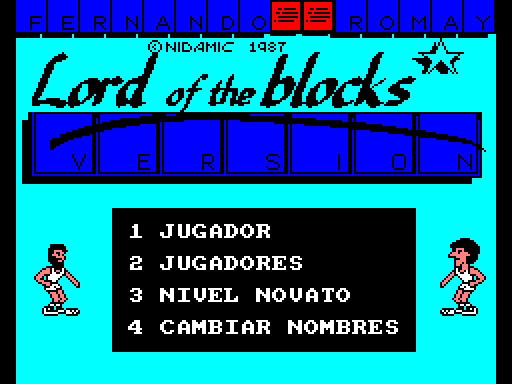

# Fernando Romay - Lord of the Blocks (MSX1, MSX2 y Amstrad CPC)

Hack de **Fernando Martín Basket Master** (Dinamic, 1987) protagonizado por Fernando Romay y José Luis «Itu» Iturriaga, con un nivel Leyenda contra Michael Jordan.

| Versión | Fichero | Cómo se carga |
| --- | --- | --- |
| MSX1 | `releases/Fernando_Romay_Lord_of_the_Blocks_MSX1.rom` (ASCII16, 64 KB) | Cartucho; en openMSX, `-romtype ASCII16` si no lo detecta |
| MSX1 | `releases/Fernando_Romay_Lord_of_the_Blocks_MSX1.cas` | `RUN"CAS:"` |
| MSX2 | `releases/Fernando_Romay_Lord_of_the_Blocks_MSX2.rom` (ASCII16, 256 KB) | Cartucho. MSX2, MSX2+ y turbo R |
| CPC | `releases/Fernando_Romay_Lord_of_the_Blocks_CPC.dsk` | `RUN"BASKET`. CPC 464 con disquetera, 664 y 6128 |

Todos los cambios, versión a versión, están en [`docs/CAMBIOS.txt`](docs/CAMBIOS.txt). Lo aprendido por el camino está en [`docs/LECCIONES.md`](docs/LECCIONES.md).



## Qué hay en el repositorio

- `releases/`: las versiones ya montadas.
- `msx/`: herramientas y parches de MSX1 y MSX2 en Python: emulador Z80 y VDP, ensamblador, conversores de gráficos y un módulo por cada parche.
- `cpc/`: lo mismo para el Amstrad CPC: emulador, módulos `p_*.py`, `build.py` y las pruebas `t_*.py`.
- `art/`: montajes del usuario que usan las builds.
- `docs/`: resumen de cambios, análisis del juego original, lecciones y capturas.

**No se incluyen los ficheros del juego original** (cinta MSX y disco CPC), ni volcados de su memoria. Para montar las versiones hace falta tener los originales.

## Cómo montar cada versión

Hace falta Python 3 con `numpy` y `Pillow`.

1. Copia la cinta original de MSX (`.cas`) en `original/`, o indica su ruta con la variable `ORIG_CAS`.
2. Copia el disco original de CPC en `cpc/in/orig.dsk`, o indica su ruta con `ORIG_DSK`.

```sh
(cd msx && python3 build_msx1.py)   # -> out/Fernando_Romay_Lord_of_the_Blocks_MSX1.cas y .rom
(cd cpc && python3 build_cpc.py)    # -> out/Fernando_Romay_Lord_of_the_Blocks_CPC.dsk
```

- **MSX1 y CPC:** las builds reproducen byte a byte los ficheros de `releases/`. Los datos que se sacan del original (`msx/state460.pkl`, `cpc/msx_ram.bin` y `cpc/msxfin_ram.bin`) se generan solos la primera vez con `msx/gen_state460.py` y `cpc/gen_msx_ram.py`.
- **MSX2:** la ROM publicada se montó en la etiqueta `msx2-1.0`. Desde `msx/` en esa etiqueta, `s5_build.build(<cinta MSX1 del hack>)` la reproduce byte a byte, aunque esas versiones antiguas usan rutas absolutas del entorno de trabajo. En la rama principal el MSX2 incorpora cambios posteriores del MSX1 (73 bytes distintos) y no está probado.

## Historial

El historial de `msx/` y `cpc/` es el del trabajo real, reescrito para quitar los ficheros del juego original y las cintas y ROM intermedias.

Etiquetas con el estado exacto de cada versión publicada:
- `msx1-1.0`: MSX1 final.
- `msx2-1.0`: MSX2 final.

Muchos scripts de prueba (`t_*.py`, `chk.py`, etc.) son herramientas de trabajo: escriben capturas en `out/` y algunos esperan ficheros que no se publican.

## Créditos

- Juego original: Dinamic Software, 1987.
- Hack, gráficos retocados y dirección: araubi.
- Testers: el grupo que probó las versiones MSX y CPC.
- Código, herramientas y documentación: desarrollados con Claude (Anthropic).

## Licencia y avisos

- **Código y herramientas** (`msx/`, `cpc/`): [MIT](LICENSE).
- **Gráficos propios y documentación** (`art/`, datos gráficos de `msx/` y `cpc/`, `docs/`): [CC BY-NC-SA 4.0](LICENSE-ART).
- **Juego original y ficheros de `releases/`:** *Fernando Martín Basket Master* es obra de Dinamic Software (1987) y sus derechos son de sus titulares. Los ficheros de `releases/` contienen el juego original modificado y no están cubiertos por ninguna de las licencias anteriores. Este hack es un homenaje sin ánimo de lucro: no se reclama ningún derecho sobre el original, y los ficheros se retirarán si los titulares lo piden.
- **Personas reales:** los nombres e imagen de Fernando Romay, José Luis Iturriaga, Fernando Martín y Michael Jordan se usan como homenaje, sin relación ni respaldo por su parte.

